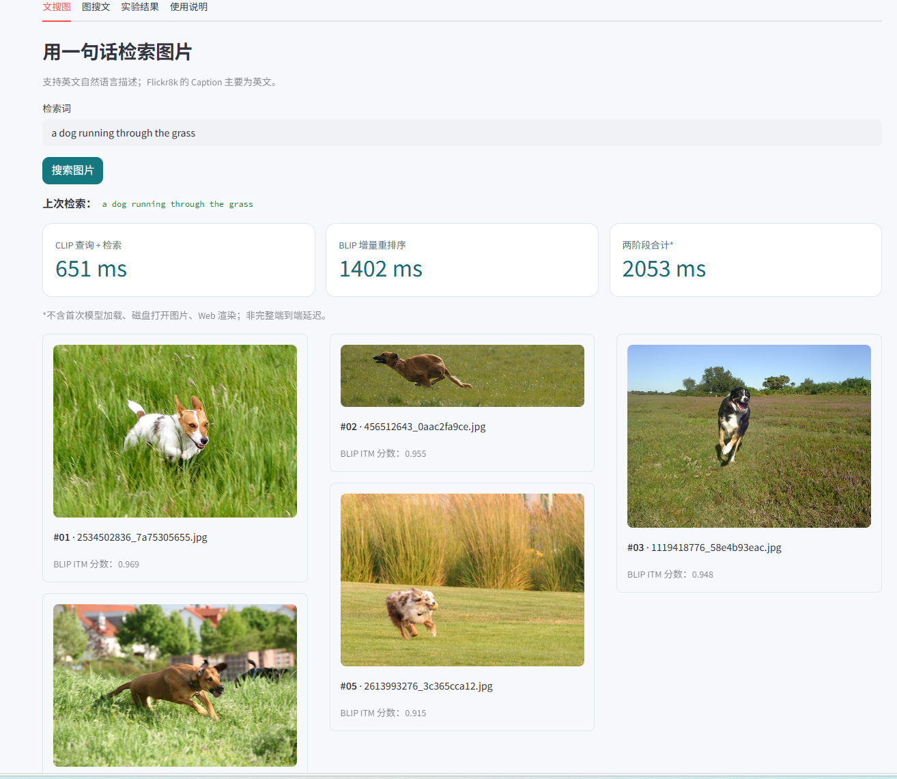
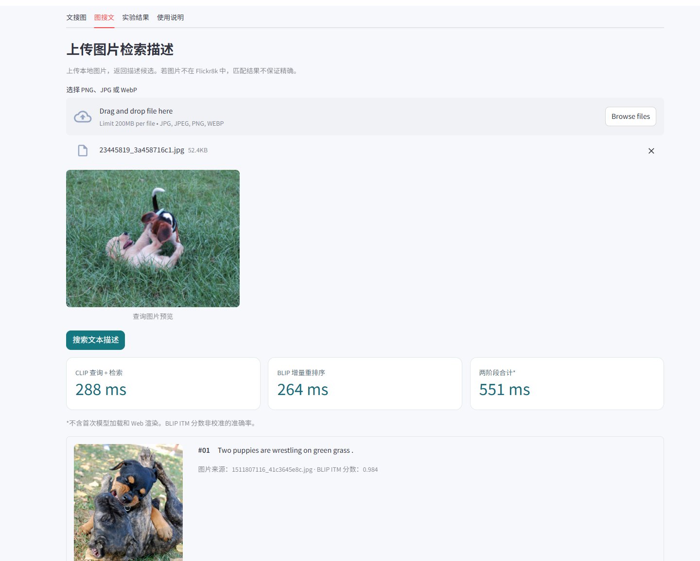
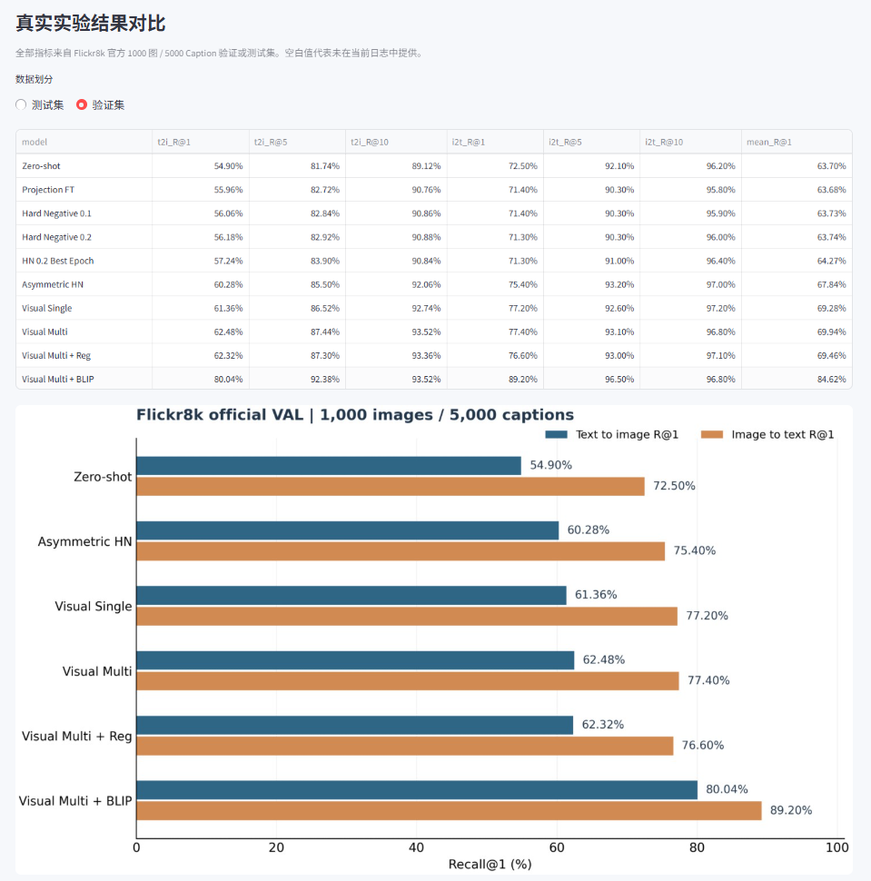

# CLIP × BLIP 图文双向检索系统

基于 PyTorch 和 Hugging Face Transformers 实现的图文跨模态检索项目，支持输入英文描述检索图片（Text-to-Image），也支持上传图片检索已有文本描述（Image-to-Text）。系统采用 CLIP 进行向量召回，再使用 BLIP Image-Text Matching（ITM）对候选结果重新排序，提供 Streamlit 交互页面及完整的训练、评测脚本。

项目主要围绕三个问题展开：如何利用同一图片的多条描述训练 CLIP，如何在不大幅增加显存开销的情况下改进双向检索，以及如何通过可重复的实验判断一个改动是否真正有效。

**Flickr8k 官方测试集结果：文搜图 R@1 79.32%，图搜文 R@1 90.70%，Mean R@1 85.01%。** 同一评测设置下，原始 CLIP 的 Mean R@1 为 62.44%。本项目使用预训练 CLIP 和 BLIP，相关增益包含 BLIP 精排器的贡献，不能全部归因于 CLIP 微调。

- 技术栈：Python、PyTorch、Transformers、CLIP ViT-B/32、BLIP ITM、NumPy、Pandas、Streamlit
- 实验设备：Windows 11，NVIDIA RTX 4060（8 GB）
- 评测数据：Flickr8k 官方图像级划分，Train / Val / Test = 6000 / 1000 / 1000 张图片；每张图片对应 5 条英文描述
- 仓库地址：https://github.com/Poseidon132/clip_multimodal_retrieval_v1

## 1. 检索效果

以下结果来自 Flickr8k 官方测试集。评测时使用 **1000 张图片、5000 条文本描述构成的测试集候选库**，两个方向分别评估后取均值。

| 方法 | 文搜图 R@1 | 图搜文 R@1 | Mean R@1 |
|:--|--:|--:|--:|
| CLIP Zero-shot | 53.78% | 71.10% | 62.44% |
| CLIP 投影层微调 | 55.04% | 70.30% | 62.67% |
| CLIP + Hard Negative（最佳轮次） | 55.14% | 70.10% | 62.62% |
| CLIP 非对称投影适配 | 58.54% | 73.10% | 65.82% |
| CLIP 视觉侧多正样本微调（Visual Multi） | 60.32% | 75.90% | 68.11% |
| **Visual Multi + BLIP Top-10 重排序** | **79.32%** | **90.70%** | **85.01%** |


相对原始 CLIP，最终方案的 Mean R@1 提高 **22.57 个百分点**。将 BLIP 加入已微调的 Visual Multi 后，Mean R@1 从 68.11% 提高至 85.01%，其中 **16.90 个百分点来自第二阶段重排序**。

R@1 指检索结果第一名命中正确样本的比例，不是图像分类准确率。文搜图要求命中对应图片；图搜文则以该图片的 5 条标注描述中的任意一条作为正确结果。

更多完整指标和实验记录见 [实验报告](reports/PROJECT_RESULTS_CN.md) 与 [原始结果汇总表](reports/observed_metrics.csv)。缺失的实验指标不使用推测值补齐。

## 2. 我主要做的工作

### 数据组织与双向检索评测

按照 Flickr8k 官方划分整理图片与 Caption，保留每图 5 条描述，并在数据准备阶段检查图像缺失、Caption 数量和划分重叠。实现文搜图和图搜文的 Recall@1/5/10 评测，保证模型选择使用验证集、最终测试采用固定配置。

对应代码：[`scripts/prepare_flickr8k_official.py`](scripts/prepare_flickr8k_official.py)、[`src/evaluate.py`](src/evaluate.py)、[`src/metrics.py`](src/metrics.py)。

### 视觉侧参数微调与多正样本学习

以 `openai/clip-vit-base-patch32` 为基础，比较双侧 Projection 微调、困难负样本、非对称投影和视觉侧微调。最终选择仅更新 `visual_projection`：保留文本编码器、视觉主干和文本投影层的预训练参数，减少对原有文本语义空间的扰动。

针对 Flickr8k 一图多描述的特点，实现多正样本对比损失。一个 batch 中同一图片对应的 5 条 Caption 都作为正样本参与图搜文方向的优化，避免把另一条正确描述当成负样本。损失中的相似度与 `logsumexp` 在 FP32 中计算，用于降低混合精度训练时的数值风险。

同时比较单条 Caption、多正样本以及特征保持正则化，按验证集 Mean R@1 保存最佳权重，而非直接使用最后一轮。

对应代码：[`src/multi_positive.py`](src/multi_positive.py)、[`src/model.py`](src/model.py)、[`scripts/train_visual.py`](scripts/train_visual.py)。

### CLIP 召回与 BLIP 精排

将图像和文本编码为归一化向量，利用余弦相似度完成第一阶段候选检索；对 CLIP Top-10 图文对调用 `Salesforce/blip-itm-base-coco` 的 ITM 匹配头打分，并重新排序。通过完整验证集比较 CLIP 与 BLIP 分数的融合权重，最终固定 `alpha=1.0`，即 CLIP 决定候选集合，BLIP 决定候选内部顺序。

实现候选召回上限统计，用于判断继续扩大 Top-K 是否值得。完整验证集上，CLIP Top-10 的候选命中率为文搜图 93.52%、图搜文 96.80%；这个数值是理想精排器的 R@1 上限，**不是** BLIP 的实测准确率。

对应代码：[`src/search.py`](src/search.py)、[`src/blip_rerank.py`](src/blip_rerank.py)、[`scripts/eval_blip_rerank.py`](scripts/eval_blip_rerank.py)、[`scripts/check_clip_candidate_ceiling.py`](scripts/check_clip_candidate_ceiling.py)。

### 训练对照、部署与工程处理

实现 Best Checkpoint、Early Stopping、配置文件驱动训练及消融对照；给特征索引保存编码器名称、Adapter 模式和权重 SHA-256，检索时检查索引是否与当前模型一致，避免更换权重后继续使用旧向量索引。

Streamlit 页面提供文搜图、图搜文、CLIP 快速模式、BLIP 精确模式、分阶段耗时、结果 CSV 导出和实验结果查看。另包含不依赖 Flickr8k 的玩具数据集，用于验证项目基础运行链路。

对应代码：[`src/index_metadata.py`](src/index_metadata.py)、[`src/checkpointing.py`](src/checkpointing.py)、[`app.py`](app.py)、[`tests/`](tests/)。

## 3. 方法流程

```text
输入：英文文本 / 图片
          |
          v
   CLIP ViT-B/32 编码
   - 冻结预训练主干及文本侧
   - Flickr8k 多正样本训练视觉投影
          |
          v
   特征 L2 归一化 + 余弦相似度
          |
          v
   向量检索，召回 Top-10
          |
          v
   BLIP ITM 逐对匹配并重排序
          |
          v
   输出图片 / 已有 Caption 的 Top-K 结果
```

这里的图搜文是**从现有 Caption 库中检索文本**，不是生成新的图片描述。系统使用精确向量检索，不包含 FAISS 或分布式向量数据库。

## 4. 消融实验与模型选择


## 系统运行展示

基于 Streamlit 实现图文双向检索，支持 CLIP 快速检索与 BLIP Top-10 精细重排序。以下为本地 RTX 4060 环境下的实际运行结果。

### 1. 文本检索图片

输入英文描述 `a dog running through the grass`，系统返回相关图片及 BLIP 匹配分数。



### 2. 图片检索文本

上传图片后，系统返回与图片语义相关的文本描述，并显示各阶段检索耗时。



### 3. 实验结果对比

Flickr8k 官方测试集上，CLIP + BLIP Top-10 重排序的文搜图 R@1 为 79.32%，图搜文 R@1 为 90.70%，Mean R@1 为 85.01%。



> 注：以上准确率基于官方测试集 1000 张图片和 5000 条描述，Web 全量索引包含 8000 张图片和 40000 条描述。
  

## 5. 环境与安装

项目在 Windows 11 + RTX 4060 8 GB 上完成训练和评测。主要依赖 PyTorch、Transformers、Pillow、NumPy、Pandas、PyYAML 和 Streamlit。首次运行会从 Hugging Face 下载 CLIP / BLIP 预训练权重，需具备相应网络访问条件。

```powershell
# 在 VSCode PowerShell 中执行
git clone https://github.com/Poseidon132/clip_multimodal_retrieval_v1.git
cd clip_multimodal_retrieval_v1

# 建议使用独立 Python 环境；GPU 版 PyTorch 请按本机 CUDA 环境安装
# https://pytorch.org/get-started/locally/
python -m pip install -r requirements.txt
python scripts/verify_env.py
python -m pytest -q tests
```

仓库中不包含 Flickr8k 原始数据、训练生成的 `.pt` 权重和 `.npz` 特征索引。仅 `git clone` 无法直接复现正式 Web 检索结果，需按下文准备数据并训练或自行配置已训练的 Adapter。

### 不下载 Flickr8k 时的基础测试

仓库提供少量程序生成的颜色与几何形状图片，可先执行：

```powershell
.\run_toy_demo.ps1
```

这个示例主要用于检查环境、编码器、索引构建和检索命令能否正常执行，**不用于评估真实图文检索性能**。

## 6. 数据准备与完整复现

### 6.1 Flickr8k 数据目录

自行合法获取 Flickr8k 图片、标注及官方训练/验证/测试划分文件，整理为：

```text
data/flickr8k/
├── Images/
│   ├── *.jpg
│   └── ...
└── text/
    ├── Flickr8k.token.txt
    ├── Flickr_8k.trainImages.txt
    ├── Flickr_8k.devImages.txt
    └── Flickr_8k.testImages.txt
```

生成带 `image, caption, split` 三列的官方划分 CSV：

```powershell
python scripts/prepare_flickr8k_official.py
```

脚本检查 6000 / 1000 / 1000 张图、每图 5 条描述和图片文件是否齐全，并输出 `data/flickr8k/captions_official.csv`。

### 6.2 视觉侧多正样本训练

```powershell
python scripts/train_visual.py --config configs/flickr8k_visual_multi.yaml
```

默认使用每图 5 条 Caption、`batch_size=12`、`learning_rate=2e-5`，最多训练 10 轮，基于验证集 Mean R@1 保存最佳模型。输出：

```text
artifacts/flickr8k_visual_multi/
├── adapter.pt         # 最佳验证轮次
├── adapter_last.pt    # 最后一轮
├── best_model.json
├── train_history.json
└── run_summary.json
```

### 6.3 建立向量索引

```powershell
python -m src.features `
  --csv data/flickr8k/captions_official.csv `
  --image-root data/flickr8k/Images `
  --adapter artifacts/flickr8k_visual_multi/adapter.pt `
  --adapter-mode image-only `
  --batch-size 32 `
  --output artifacts/flickr8k_visual_multi_index.npz
```

索引包含 8000 张官方划分图片的向量及 40000 条描述的向量。更换 Adapter 后需要重新生成对应索引。

### 6.4 CLIP 双向检索验证

```powershell
python -m src.evaluate `
  --csv data/flickr8k/captions_official.csv `
  --image-root data/flickr8k/Images `
  --split val `
  --adapter artifacts/flickr8k_visual_multi/adapter.pt `
  --adapter-mode image-only `
  --batch-size 32 `
  --output artifacts/visual_multi_val.json
```

### 6.5 BLIP Top-10 重排序与测试

先在完整验证集检查融合权重：

```powershell
python scripts/eval_blip_rerank.py `
  --split val `
  --index artifacts/flickr8k_visual_multi_index.npz `
  --adapter artifacts/flickr8k_visual_multi/adapter.pt `
  --adapter-mode image-only `
  --sample-text-queries 0 `
  --sample-image-queries 0 `
  --top-k 10 `
  --batch-size 4 `
  --output artifacts/blip_visual_multi_val_full.json
```

本项目在完整验证集上选出 `alpha=1.0`，测试集使用固定权重：

```powershell
python scripts/eval_blip_rerank.py `
  --split test `
  --index artifacts/flickr8k_visual_multi_index.npz `
  --adapter artifacts/flickr8k_visual_multi/adapter.pt `
  --adapter-mode image-only `
  --sample-text-queries 0 `
  --sample-image-queries 0 `
  --top-k 10 `
  --alpha 1.0 `
  --batch-size 4 `
  --output artifacts/blip_visual_multi_test_final.json
```

以上是复现已固定配置的命令。请勿根据测试集结果再次调整训练超参数、Top-K 或融合权重。

## 7. 启动 Web 检索

训练并生成索引后，在项目根目录执行：

```powershell
streamlit run app.py --server.fileWatcherType none
```

`--server.fileWatcherType none` 用于规避某些 Windows 环境中 Streamlit 文件监控与 `torch.classes` 的兼容性报错。打开终端给出的 `http://localhost:8501` 即可使用。

页面包含文搜图、图搜文、实验结果和使用说明四个标签页。可切换 CLIP 快速检索或 BLIP 精确检索，并查看候选得分、分阶段耗时及导出的 CSV 结果。默认使用：

```text
Adapter  artifacts/flickr8k_visual_multi/adapter.pt
Index    artifacts/flickr8k_visual_multi_index.npz
CLIP     openai/clip-vit-base-patch32
BLIP     Salesforce/blip-itm-base-coco
Mode     image-only
Top-K    10（BLIP 精排候选数）
```

本地测试集评估中，BLIP 阶段的平均增量耗时约为文搜图 **0.194 秒/查询**、图搜文 **0.201 秒/查询**；该统计不包括首次模型加载、CLIP 编码和页面渲染。RTX 4060 上的 BLIP 评测脚本报告峰值分配显存约 0.53 GB，不能理解为整个应用的总显存需求。

## 8. 代码结构

```text
clip_multimodal_retrieval_v1/
├── app.py                         # Streamlit 双向检索页面
├── configs/                       # CLIP / BLIP 训练配置
├── src/
│   ├── model.py                   # CLIP 加载、编码与 Adapter
│   ├── multi_positive.py          # 多正样本对比损失
│   ├── visual_data.py             # 按图片组织多条 Caption
│   ├── blip_rerank.py             # BLIP ITM 打分与重排
│   ├── blip_itm_training.py       # BLIP ITM 微调支持
│   ├── features.py                # 图文特征提取与索引
│   ├── search.py                  # 向量检索
│   ├── evaluate.py                # 双向检索评价
│   └── index_metadata.py          # 索引和 Adapter 一致性检查
├── scripts/
│   ├── prepare_flickr8k_official.py
│   ├── train_visual.py
│   ├── train_blip_itm.py
│   ├── eval_blip_rerank.py
│   ├── check_clip_candidate_ceiling.py
│   └── build_release_report.py
├── reports/
│   ├── PROJECT_RESULTS_CN.md
│   ├── observed_metrics.csv
│   ├── index.html
│   └── figures/
├── tests/                         # 指标、损失、索引、训练模块测试
└── requirements.txt
```

运行以下命令可重新生成本地实验汇总页面与图表：

```powershell
python scripts/build_release_report.py
```

## 9. 实验范围与不足

- 公开成绩对应 Flickr8k 官方测试集的 1000 张图片和 5000 条描述。Streamlit 默认使用 8000 图、40000 描述的全量向量索引，因此网页检索难度与测试集评测不同，不能直接将 85.01% 套用于全量索引。
- BLIP 使用额外的 COCO 预训练图文匹配模型。CLIP 多正样本训练与 BLIP 预训练带来的效果已分别列出，二者贡献不混淆。
- 验证实验主要基于单次随机种子及 Flickr8k，没有进行多种子置信区间分析或 Flickr30k / COCO 上的外部评测。
- 在开发过程中曾检查过若干早期方案的测试集结果，因此此处的最终测试结果不应描述为全过程严格盲测。
- GitHub 仅发布程序、配置、玩具数据与结果汇总。Flickr8k 数据、CLIP / BLIP 模型权重和本地微调权重需自行获得或训练，并遵守原始使用条款。

## 10. 相关资料

- [CLIP: Learning Transferable Visual Models From Natural Language Supervision](https://arxiv.org/abs/2103.00020)
- [BLIP: Bootstrapping Language-Image Pre-training for Unified Vision-Language Understanding and Generation](https://arxiv.org/abs/2201.12086)
- [OpenAI CLIP ViT-B/32（Hugging Face）](https://huggingface.co/openai/clip-vit-base-patch32)
- [Salesforce BLIP ITM Base COCO（Hugging Face）](https://huggingface.co/Salesforce/blip-itm-base-coco)
- [实验成果报告](reports/PROJECT_RESULTS_CN.md)
- [第三方模型及数据说明](THIRD_PARTY.md)
