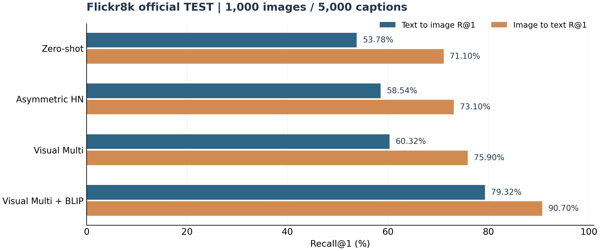
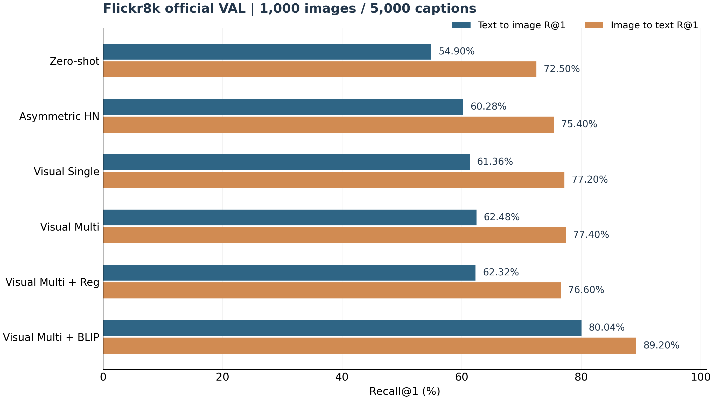

# CLIP × BLIP 跨模态图文检索系统｜实验成果报告

**版本：v1.6 成果整理稿。** 指标来自实际控制台日志；运行报告脚本时，存在的本地原始 JSON 可补齐缺失项目。

## 研究任务与实验设置

- **数据集：** Flickr8k，使用官方划分：Train 6000、Val 1000、Test 1000 张图，每张 5 条文本描述。
- **基座：** `openai/clip-vit-base-patch32`；只更新 `visual_projection`，文本侧保留预训练参数。
- **训练改进：** 多正样本文本（每图 5 条 Caption），按验证集 Mean R@1 保存最佳模型。
- **精排器：** 预训练 `Salesforce/blip-itm-base-coco`，CLIP Top-10 召回后仅在十个候选内进行 BLIP ITM 重排序；验证集选定 `alpha=1.0`。
- **评价：** 文搜图 T→I 与图搜文 I→T 的 Recall@1/5/10；Mean R@1 为两方向 R@1 的算术平均。
- **候选库：** 官方 Val/Test 的每次完整评估都在 1000 图／5000 Caption 库上进行；Web 索引覆盖 8000 图／40000 Caption，因此 Web 不能直接套用测试集成绩。

## 正式测试集对比

| 方法 | T→I R@1 | R@5 | R@10 | I→T R@1 | R@5 | R@10 | Mean R@1 |
|---|---:|---:|---:|---:|---:|---:|---:|
| Zero-shot | 53.78% | 80.78% | 88.82% | 71.10% | 91.90% | 95.70% | 62.44% |
| Projection FT | 55.04% | 81.58% | 89.70% | 70.30% | 91.00% | 94.80% | 62.67% |
| HN 0.2 Best Epoch | 55.14% | 83.22% | 90.84% | 70.10% | 90.40% | 95.20% | 62.62% |
| Asymmetric HN | 58.54% | — | — | 73.10% | — | — | 65.82% |
| Visual Multi | 60.32% | 86.34% | 93.02% | 75.90% | 93.60% | 96.80% | 68.11% |
| Visual Multi + BLIP | 79.32% | 92.00% | 93.02% | 90.70% | 96.60% | 96.80% | 85.01% |

**最优模型（官方测试集）：** T→I R@1 **79.32%**；I→T R@1 **90.70%**；Mean R@1 **85.01%**。
与 CLIP Zero-shot **62.44%** 相比提升 **22.57 个百分点**；与 Visual Multi（无 BLIP）**68.11%** 相比提升 **16.90 个百分点**。
这里的 R@1 是检索命中率，不是分类准确率，也不是单次请求匹配概率。

## 验证集消融

| 方法 | T→I R@1 | R@5 | R@10 | I→T R@1 | R@5 | R@10 | Mean R@1 |
|---|---:|---:|---:|---:|---:|---:|---:|
| Zero-shot | 54.90% | 81.74% | 89.12% | 72.50% | 92.10% | 96.20% | 63.70% |
| Projection FT | 55.96% | 82.72% | 90.76% | 71.40% | 90.30% | 95.80% | 63.68% |
| Hard Negative 0.1 | 56.06% | 82.84% | 90.86% | 71.40% | 90.30% | 95.90% | 63.73% |
| Hard Negative 0.2 | 56.18% | 82.92% | 90.88% | 71.30% | 90.30% | 96.00% | 63.74% |
| HN 0.2 Best Epoch | 57.24% | 83.90% | 90.84% | 71.30% | 91.00% | 96.40% | 64.27% |
| Asymmetric HN | 60.28% | 85.50% | 92.06% | 75.40% | 93.20% | 97.00% | 67.84% |
| Visual Single | 61.36% | 86.52% | 92.74% | 77.20% | 92.60% | 97.20% | 69.28% |
| Visual Multi | 62.48% | 87.44% | 93.52% | 77.40% | 93.10% | 96.80% | 69.94% |
| Visual Multi + Reg | 62.32% | 87.30% | 93.36% | 76.60% | 93.00% | 97.10% | 69.46% |
| Visual Multi + BLIP | 80.04% | 92.38% | 93.52% | 89.20% | 96.50% | 96.80% | 84.62% |

验证集选择了 Visual Multi 的最佳视觉投影（Epoch 8），并在完整验证集 6000 次查询上选择 BLIP `alpha=1.0`。
Multi 正则项 `0.2` 并未超过无正则的 Visual Multi；这只能说明当前设置没有改善验证集平均表现。

## 推理效率（RTX 4060 8 GB，本地日志）

| 指标 | 实测 | 说明 |
|---|---:|---|
| BLIP 文搜图阶段 | 0.194 秒/查询 | Top-10 重排序的平均增量耗时，不含 CLIP 编码/首次模型加载 |
| BLIP 图搜文阶段 | 0.201 秒/查询 | 同上 |
| BLIP GPU 峰值分配显存 | 0.53 GB | 仅脚本报告的相关阶段统计值，不代表整套系统峰值显存 |

## 结果可追溯与局限

- 保留 `reports/observed_metrics.csv` 与 `reports/final_comparison.csv`（后一份为本地 JSON 可补全版）；未给出或未找到原始 JSON 的指标保持空白，不使用推测数。
- 固定的验证集最佳 `alpha=1.0` 仅在测试集运行一次固定配置的 BLIP 重排序。此前开发阶段也多次观察过测试集其他模型结果，因此不应宣称全过程是严格盲测。
- BLIP 为独立的 COCO 预训练模型，未在本项目中重新训练；重排序增益不能全部归因于视觉微调。
- Top-10 内重排序无法提高同一候选集的 R@10，R@5/R@1 可通过调整顺序改善。
- 未提供多随机种子/置信区间与外部数据集测试，现阶段不宣称统计显著或跨数据集泛化。
- 若原始 JSON 与用户终端记录冲突，脚本会打印差异并保留用户终端数据，等待人工确认。

## 项目技术栈

Python、PyTorch、Transformers、CLIP ViT-B/32、BLIP ITM、对比学习、多正样本损失、向量余弦检索、Streamlit、NumPy、Pandas、Matplotlib。

## 结果来源（本地原始文件）

- `val` · Zero-shot：`artifacts/flickr8k_val_zero_shot.json`
- `val` · Projection FT：`artifacts/flickr8k_val_projection.json`
- `val` · Hard Negative 0.1：`artifacts/flickr8k_val_hard_negative_01.json`
- `val` · Hard Negative 0.2：`artifacts/flickr8k_val_hard_negative_02.json`
- `val` · HN 0.2 Best Epoch：`artifacts/flickr8k_best_hn02_val.json`
- `val` · Asymmetric HN：`artifacts/flickr8k_asymmetric_val.json`
- `val` · Visual Single：`artifacts/visual_single_val.json`
- `val` · Visual Multi：`artifacts/visual_multi_val.json`
- `val` · Visual Multi + Reg：`artifacts/visual_multi_reg_val.json`
- `val` · Visual Multi + BLIP：`artifacts/blip_visual_multi_val_full.json`
- `test` · Zero-shot：`artifacts/flickr8k_official_zero_shot.json`
- `test` · Projection FT：`artifacts/flickr8k_projection_test.json`
- `test` · HN 0.2 Best Epoch：`artifacts/flickr8k_best_hn02_test.json`
- `test` · Asymmetric HN：`terminal output only`
- `test` · Visual Multi：`artifacts/blip_visual_multi_test_final.json#clip_baseline`
- `test` · Visual Multi + BLIP：`artifacts/blip_visual_multi_test_final.json`
